<!-- Custom Dhruv Tara Cosmic Banner -->
<div align="center">
  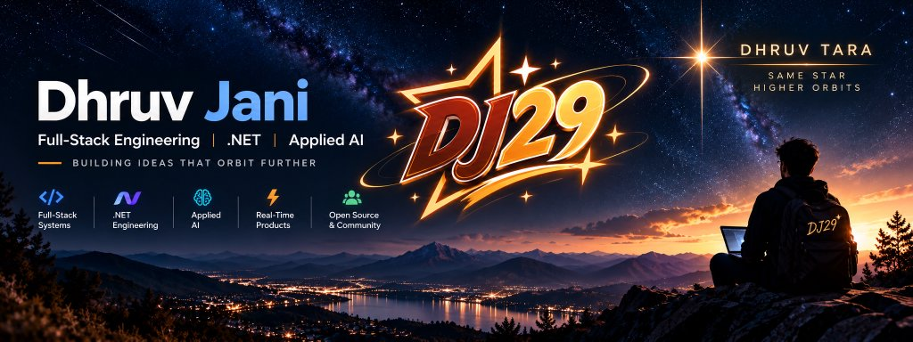
</div>

<div align="center">
  
</div>

<div align="center">
  
</div>

<div align="center">
  <br/>
  <a href="#milestones"><b>✦ MILESTONES</b></a>&nbsp;·&nbsp;
  <a href="#signals"><b>✦ SIGNALS</b></a>&nbsp;·&nbsp;
  <a href="#orbiters"><b>✦ ORBITERS</b></a>&nbsp;·&nbsp;
  <a href="#stack"><b>✦ STACK</b></a>&nbsp;·&nbsp;
  <a href="#uplink"><b>✦ UPLINK</b></a>
</div>

<a name="featured-mission"></a>

### 🌠 Featured Mission · ShelfTalk

<table width="100%">
  <tr>
    <td width="62%" valign="top">
      <b>Turning reading lists into living conversations.</b><br/><br/>
      ShelfTalk is a social reading community where readers discover books, join genre clubs, chat in real time, coordinate synchronized reading rooms, and keep personal reading diaries.
      <br/><br/>
      <b>Why it stands out:</b> revived and shipped as a polished, deployed product with Socket.io-powered live collaboration.
    </td>
    <td width="38%" valign="top">
      <b>MISSION STATUS</b><br/>
      🏆 1 of 10 Global Challenge Winners<br/>
      💰 $300 Finish-Up-A-Thon Prize<br/>
      ⚡ React · Node · Socket.io<br/><br/>
      <a href="https://shelftalk-community.vercel.app/"><b>Visit the live orbit →</b></a><br/>
      <a href="https://github.com/JaniDhruv/ShelfTalk"><b>Read the source mission →</b></a>
    </td>
  </tr>
</table>

<div align="center">

  <!-- Typing SVG (Golden Star Glow) -->
  <a href="https://github.com/JaniDhruv">
    
  </a>

  <br/><br/>

  <!-- Mission links -->
  <a href="https://www.linkedin.com/in/dhruv-jani-dj29/" target="_blank">
    
  </a>
  &nbsp;
  <a href="https://dev.to/dj29" target="_blank">
    
  </a>
  &nbsp;
  <a href="mailto:dhruvdjani29@gmail.com">
    
  </a>

</div>

<br/>

### 🌌 The Dhruv Tara Philosophy

> *"In Sanskrit, **Dhruva (ध्रुव)** is the Pole Star—the eternal, steadfast anchor around which galaxies revolve. In software, I engineer with that exact philosophy: rock-solid foundations, resilient architectures, and local-first systems that stay online when everything else is in flux."*  
>  
> 🌟 **"Same star, higher orbits."**

<div align="center">
  <sub>✦ MISSION CONTROL ONLINE · DEEP-SPACE ENGINEERING · LOCAL-FIRST SYSTEMS ✦</sub>
</div>

```yaml
identity: Dhruv Jani (ध्रुव / The Pole Star)
status: Final-Year B.Tech CE @ DDU → Incoming Trainee Engineer @ Simform 🚀
coordinate: Vadodara, Gujarat, India 📍
constellation: [Full-Stack Systems, .NET Engineering, Applied AI, Open Source & Community]
gravitational_pull: Forem Core Contributor (10 Merged PRs) • 8x Contributor Club
stargazers: DEV Trusted Member (@dj29) • 15,800+ Followers • 36,600+ Reads
orbiting: Local-first AI daemons · Real-time systems · High-scale dev tooling
writing: dev.to/dj29 (Top Author: #rails, #ruby, #discuss)
ask_me_about: [React, Next.js, Node/Express, Ruby on Rails, C# / ASP.NET, Python, Socket.io, Gemini/Gemma, Local-First AI]
```

<div align="center">
  
</div>

---

<a name="milestones"></a>

### 🏆 High-Orbit Milestones · Signal Strength

| 🌟 Orbit | Celestial Achievement / Description | 🗓️ Solar Year |
| :---: | :--- | :---: |
| 🥇 **Hackathon Winner** | [**Best Use of GitHub Copilot ($100 Prize)**](https://dev.to/dj29/i-built-slothd-a-local-first-offline-capable-ai-daemon-that-patiently-organizes-your-messy-53e7) — Hacktoberfest 2026 *(slothd)* | Fall 2026 |
| 🥇 **Global Challenge Winner** | [**1 of 10 Global Challenge Winners — $300 Prize**](https://dev.to/devteam/congrats-to-the-github-finish-up-a-thon-challenge-winners-1k0h) — GitHub Copilot Finish-Up-A-Thon *(ShelfTalk)* | Fall 2026 |
| 🌍 **Open Source** | [**10 Merged PRs in forem/forem**](https://github.com/forem/forem/pulls?q=is%3Apr+author%3AJaniDhruv+is%3Amerged) — 4x & 8x DEV Contributor Club *(Platform Core)* | 2026 |
| ✍️ **Community Authority** | [**DEV Trusted Member**](https://dev.to/dj29) — 15,800+ Stargazers • 36,600+ Reads across 30+ deep-dive articles | 2026 |
| 🎤 **Community Leadership** | **Official Meetup Host** — Hacktoberfest 2026 Meetup @ DDU Nadiad | Fall 2026 |

<div align="center">
  
</div>

---

<a name="signals"></a>

### ✍️ Stargazers & Community Impact · Incoming Signals ([@dj29](https://dev.to/dj29))

<div align="center">

  <!-- Live Cosmic Metrics Grid -->
  <a href="https://dev.to/dj29" target="_blank">
    
  </a>
  &nbsp;
  <a href="https://dev.to/dj29" target="_blank">
    
  </a>
  &nbsp;
  <a href="https://dev.to/dj29" target="_blank">
    
  </a>
  &nbsp;
  <a href="https://github.com/forem/forem/pulls?q=is%3Apr+author%3AJaniDhruv+is%3Amerged" target="_blank">
    
  </a>
  &nbsp;
  <a href="https://dev.to/dj29" target="_blank">
    
  </a>

  <br/><br/>

  <!-- Organizations -->
  <p>
    <strong>🏢 Organizations:</strong>&nbsp;
    <a href="https://dev.to/the-devengers" target="_blank"></a>
    &nbsp;
    <a href="https://dev.to/necoz" target="_blank"></a>
  </p>

</div>

> 🛡️ **Trusted Member & Community Moderator (DEV Community • 4M+ Developers):**  
> • Granted platform moderation privileges to evaluate technical accuracy, rank post quality via algorithmic weighting, and triage spam across a global developer ecosystem.  
> • Actively rate content experience levels and enforce Code of Conduct integrity to maintain high-signal engineering feeds for over 4 million developers.

<div align="center">
  
</div>

---

### 🏅 Hall of Trophies · Official DEV Constellation

<div align="center">

<table align="center" width="100%">
  <tr>
    <td align="center" width="20%" valign="top">
      <a href="https://dev.to/dj29" target="_blank">
        
      </a>
      <br/>
      <b>Hacktoberfest Winner</b><br/>
      <sub>🏆 Best Use of GitHub Copilot ($100 Prize)</sub>
    </td>
    <td align="center" width="20%" valign="top">
      <a href="https://dev.to/dj29" target="_blank">
        
      </a>
      <br/>
      <b>Finish-Up-A-Thon</b><br/>
      <sub>🏆 1 of 10 Global Challenge Winners • $300 Prize</sub>
    </td>
    <td align="center" width="20%" valign="top">
      <a href="https://dev.to/dj29" target="_blank">
        
      </a>
      <br/>
      <b>8x Contributor Club</b><br/>
      <sub>🛠️ 10 Merged PRs in forem/forem Core</sub>
    </td>
    <td align="center" width="20%" valign="top">
      <a href="https://dev.to/dj29" target="_blank">
        
      </a>
      <br/>
      <b>4x Contributor Club</b><br/>
      <sub>🛠️ Core Forem Engine Contributor</sub>
    </td>
    <td align="center" width="20%" valign="top">
      <a href="https://dev.to/dj29" target="_blank">
        
      </a>
      <br/>
      <b>Community Favorite</b><br/>
      <sub>💖 DEV Community Appreciation Award</sub>
    </td>
  </tr>
  <tr>
    <td align="center" width="20%" valign="top">
      <a href="https://dev.to/dj29" target="_blank">
        
      </a>
      <br/>
      <b>Ruby on Rails</b><br/>
      <sub>🏷️ Top Author Badge (#rails)</sub>
    </td>
    <td align="center" width="20%" valign="top">
      <a href="https://dev.to/dj29" target="_blank">
        
      </a>
      <br/>
      <b>Ruby</b><br/>
      <sub>🏷️ Top Author Badge (#ruby)</sub>
    </td>
    <td align="center" width="20%" valign="top">
      <a href="https://dev.to/dj29" target="_blank">
        
      </a>
      <br/>
      <b>#Discuss</b><br/>
      <sub>🏷️ Top Author Badge (#discuss)</sub>
    </td>
    <td align="center" width="20%" valign="top">
      <a href="https://dev.to/dj29" target="_blank">
        
      </a>
      <br/>
      <b>Official Meetup Host</b><br/>
      <sub>🎤 Hacktoberfest 2026 @ DDU Nadiad</sub>
    </td>
    <td align="center" width="20%" valign="top">
      <a href="https://dev.to/dj29" target="_blank">
        
      </a>
      <br/>
      <b>Completionist 2026</b><br/>
      <sub>🎯 Full Track Completionist</sub>
    </td>
  </tr>
</table>

</div>

<div align="center">
  
</div>

---

### 📝 Dispatches from Orbit · Latest Signals

<!-- ARTICLES:START -->

<table width="100%" cellpadding="10" cellspacing="0">
<tr>
<td align="center" valign="middle" width="33%"><a href="https://dev.to/devengers/the-c-trilogy-how-dennis-ritchie-bjarne-stroustrup-and-anders-hejlsberg-built-the-modern-world-1onp"></a></td>
<td align="center" valign="middle" width="33%"><a href="https://dev.to/dj29/popularity-depends-on-how-you-define-it-how-700-rss-bot-posts-took-over-devs-community-hub-414p"></a></td>
<td align="center" valign="middle" width="33%"><a href="https://dev.to/dj29/every-codebase-has-a-do-not-touch-file-i-built-an-ai-necromancer-to-summon-the-ghost-of-the-2no5"></a></td>
</tr>
<tr>
<td align="center" valign="top" width="33%" height="72"><strong><a href="https://dev.to/devengers/the-c-trilogy-how-dennis-ritchie-bjarne-stroustrup-and-anders-hejlsberg-built-the-modern-world-1onp" title="The C Trilogy: How Dennis Ritchie, Bjarne Stroustrup, and Anders Hejlsberg Built the Modern World 🏛️">The C Trilogy: How Dennis Ritchie, Bjarne Stroustrup, and…</a></strong></td>
<td align="center" valign="top" width="33%" height="72"><strong><a href="https://dev.to/dj29/popularity-depends-on-how-you-define-it-how-700-rss-bot-posts-took-over-devs-community-hub-414p" title="Popularity Depends on How You Define It: How 700 RSS Bot Posts Took Over DEV&#039;s Community Hub 🤖💥">Popularity Depends on How You Define It: How 700 RSS Bot…</a></strong></td>
<td align="center" valign="top" width="33%" height="72"><strong><a href="https://dev.to/dj29/every-codebase-has-a-do-not-touch-file-i-built-an-ai-necromancer-to-summon-the-ghost-of-the-2no5" title="Every Codebase Has a &#039;// DO NOT TOUCH&#039; File. I Built an AI Necromancer to Summon the Ghost of the Developer Who Wrote It 💀🔮">Every Codebase Has a &#039;// DO NOT TOUCH&#039; File. I Built an AI…</a></strong></td>
</tr>
<tr>
<td align="center" valign="middle" width="33%" height="32"><sub>📅 Nov 9 &nbsp;&bull;&nbsp; ⏱️ 6 min read</sub></td>
<td align="center" valign="middle" width="33%" height="32"><sub>📅 Nov 5 &nbsp;&bull;&nbsp; ⏱️ 5 min read</sub></td>
<td align="center" valign="middle" width="33%" height="32"><sub>📅 Oct 31 &nbsp;&bull;&nbsp; ⏱️ 12 min read</sub></td>
</tr>
<tr>
<td align="center" valign="middle" width="33%" height="32"><sub>❤️ 108 &nbsp;&bull;&nbsp; 💬 36</sub></td>
<td align="center" valign="middle" width="33%" height="32"><sub>❤️ 56 &nbsp;&bull;&nbsp; 💬 34</sub></td>
<td align="center" valign="middle" width="33%" height="32"><sub>❤️ 124 &nbsp;&bull;&nbsp; 💬 66</sub></td>
</tr>
</table>

<p align="right"><a href="https://dev.to/dj29"><strong>View all 30+ articles on dev.to →</strong></a></p>
<!-- ARTICLES:END -->

<div align="center">
  
</div>

---

<a name="stack"></a>

### 🛠️ The Technical Stargate · Propulsion Systems

<div align="center">

<table align="center" width="100%">
  <tr>
    <td align="left" width="50%" valign="top">
      <b>💻 Languages & Core</b><br/><br/>
      <br/>
      <sub>TypeScript • JavaScript (ES6+) • Python • C++ • C# • Java • Ruby • SQL</sub>
    </td>
    <td align="left" width="50%" valign="top">
      <b>🌐 Frontend & State</b><br/><br/>
      <br/>
      <sub>React.js • Next.js • Vite • Tailwind CSS • Redux • Blazor • HTML5/CSS3</sub>
    </td>
  </tr>
  <tr>
    <td align="left" width="50%" valign="top">
      <b>⚙️ Backend, Systems & APIs</b><br/><br/>
      <br/>
      <sub>Node.js • Express.js • Django • ASP.NET Core • Ruby on Rails • Flask • REST APIs</sub>
    </td>
    <td align="left" width="50%" valign="top">
      <b>🗄️ Databases, Cloud & DevOps</b><br/><br/>
      <br/>
      <sub>PostgreSQL • Supabase • MongoDB Atlas • SQLite • Docker • Vercel • Render</sub>
    </td>
  </tr>
  <tr>
    <td align="left" width="50%" valign="top">
      <b>🛠️ Dev Tools & Environments</b><br/><br/>
      <br/>
      <sub>Git • GitHub • Postman • VS Code • Linux • Bash / Shell Environments</sub>
    </td>
    <td align="left" width="50%" valign="top">
      <b>🤖 AI, LLMs & Machine Learning</b><br/><br/>
      <br/>
      <sub>PyTorch • Scikit-Learn • NumPy • Pandas • FastAPI • LLM Integration • Structured Outputs</sub>
    </td>
  </tr>
</table>

</div>

<div align="center">
  
</div>

---

<a name="orbiters"></a>

### 🚀 Deployed Orbiters · Deep-Space Systems

<div align="center">
<table>
  <tr>
    <td><a href="https://github.com/JaniDhruv/slothd">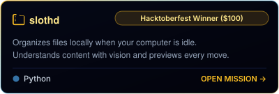</a></td>
    <td><a href="https://github.com/JaniDhruv/ShelfTalk">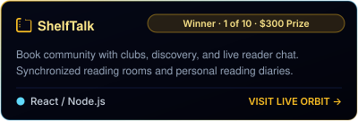</a></td>
  </tr>
  <tr>
    <td><a href="https://github.com/Tarkash-Labs/FinePrint">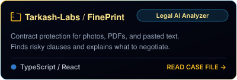</a></td>
    <td><a href="https://github.com/JaniDhruv/GitSeance">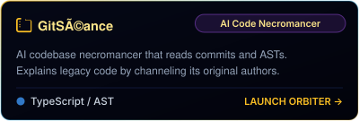</a></td>
  </tr>
  <tr>
    <td><a href="https://github.com/JaniDhruv/OriginTrace">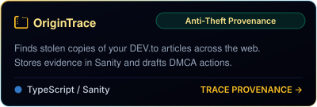</a></td>
    <td><a href="https://github.com/Edu-Trinity/EduResolve">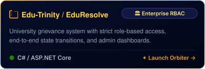</a></td>
  </tr>
  <tr>
    <td colspan="2" align="center"><a href="https://github.com/JaniDhruv/the-imitation-game">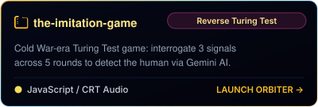</a></td>
  </tr>
</table>
</div>

<details>
<summary><b>⚡ Deep-Space Mission Logs & One-Line Pitches (click to expand)</b></summary>
<br/>

| 🛰️ Orbiter | 🌌 Mission Objective | ⚡ Propulsion & Stack |
| :--- | :--- | :--- |
| ⚡ [**slothd**](https://github.com/JaniDhruv/slothd) | **Hacktoberfest 2026 Winner ($100 Prize)** — A local-first AI organizer that waits for system idle time, understands file content, previews its plan, and lets you undo every move. | Python · Multimodal AI · Local-First Daemon |
| 📚 [**ShelfTalk**](https://github.com/JaniDhruv/ShelfTalk) | **GitHub Copilot Finish-Up-A-Thon Winner** — A social reading community where people discover books, join genre clubs, chat live, share reading rooms, and keep a reading diary. | React · Vite · Node/Express · Socket.io · MongoDB Atlas |
| 📜 [**FinePrint**](https://github.com/Tarkash-Labs/FinePrint) | Upload a photo, PDF, or pasted contract and get clause-level risk explanations, negotiation guidance, and a clear verdict before signing. | React · Vite · FastAPI · Gemma 4 · SSE Streaming |
| 🔍 [**GitSéance**](https://github.com/JaniDhruv/GitSeance) | An AI codebase necromancer that traverses commit history and ASTs, then channels the original authors to explain intimidating legacy code. | TypeScript · AI Agents · AST Parser · Git History |
| 🛡️ [**OriginTrace**](https://github.com/JaniDhruv/OriginTrace) | Paste a DEV.to article URL to find stolen copies, persist structured evidence in Sanity, determine attribution, and generate DMCA takedown actions with an AI agent. | TypeScript · Sanity Context MCP · Knowledge Base API |
| 🏛️ [**EduResolve**](https://github.com/Edu-Trinity/EduResolve) | A campus complaint workflow for students, faculty, and HODs to submit, track, triage, and escalate academic or administrative issues with 72-hour monitoring. | C# · ASP.NET Core MVC · SQL Server · Entity Framework |
| 🕵️ [**the-imitation-game**](https://github.com/JaniDhruv/the-imitation-game) | A classified 1950s terminal game where a GCHQ analyst interrogates Gemini-powered suspects on the summer solstice to identify the human operative. | JavaScript · Gemini API · Web Audio API · Vanilla CRT |

</details>

<div align="center">
  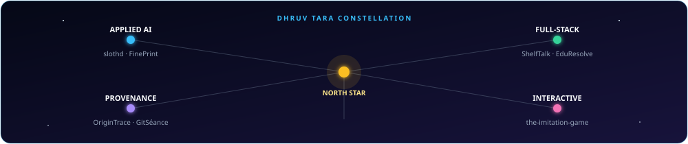
</div>

<div align="center">
  
</div>

---

### 📊 Orbital Telemetry · Constellation Stats

<div align="center">

  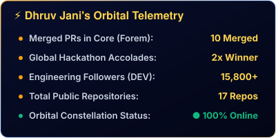
  

  <br/>

  

</div>

<div align="center">
  
</div>

---

<a name="uplink"></a>

### 🤝 Establish Uplink · Open Channel

Open to discussing full-stack engineering, local-first AI, hackathons, open source, or opportunities.

<p align="center">
  <a href="https://www.linkedin.com/in/dhruv-jani-dj29/" target="_blank">
    
  </a>
  &nbsp;
  <a href="https://dev.to/dj29" target="_blank">
    
  </a>
  &nbsp;
  <a href="mailto:dhruvdjani29@gmail.com">
    
  </a>
  &nbsp;
  <a href="https://github.com/JaniDhruv">
    
  </a>
</p>

<p align="center">
  <i>✨ "Same Star, Higher Orbits." — Engineered by <a href="https://github.com/JaniDhruv">Dhruv Jani</a> (Dhruv Tara) 🌟</i>
</p>

<!-- Animated gradient footer -->

